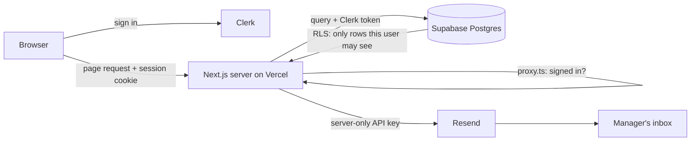

# PMS1: Performance Management System

A web app that runs a company's appraisal cycle end to end. HR opens a cycle, employees set weighted goals, managers approve them, employees self-appraise, managers review side by side, and HR sees who is done. Built for a ~200-person services company that currently runs appraisals on email and Excel.

**Live:** https://pms1-17-11-2026.vercel.app
**Stack:** Next.js 16 (App Router, TypeScript, Tailwind) · Clerk (auth) · Supabase (Postgres + Row Level Security) · Resend (email) · Vercel (hosting)

| Doc | What's in it |
|---|---|
| [RESEARCH.md](RESEARCH.md) | The HR research behind the design: KRA/KPI, SMART, cycles, rating scales, bell curve, OKRs, 3 real products, sensitive data |
| [docs/data-model.md](docs/data-model.md) | ER diagram, status workflows, and who can see what |
| [docs/EXPLAIN.md](docs/EXPLAIN.md) | What every file does, plus likely demo questions |
| [docs/BUILD_LOG.md](docs/BUILD_LOG.md) | The lab manual's steps, how each was done, and how to verify it |
| [supabase/](supabase) | The SQL: `01_schema.sql`, `02_security.sql`, `03_seed.sql`, `04_reset_demo.sql` |

---

## Test accounts

The Clerk instance is in **development mode**. Any email containing `+clerk_test` signs in with the verification code **`424242`**, and no real email is sent.

| Role | Name | Sign in with |
|---|---|---|
| HR Admin | Asha Rao | `hr+clerk_test@example.com` → code `424242` |
| Manager | Vikram Mehta | the project owner's real Gmail (it receives the notification emails) |
| Employee | Priya Sharma | `priya+clerk_test@example.com` → code `424242` |
| Employee | Rahul Nair | `rahul+clerk_test@example.com` → code `424242` |

> **First time for each test account:** use **Sign up** (not Sign in) with the test email. If Clerk asks for a password, pick any; the email code is `424242`. After that, Sign in works normally. Use a private/incognito window, or sign out, to switch between users.
>
> To add a new person: sign in as HR → **Employees → Add employee**. Use the exact email they'll sign in with. Their first sign-in links their login to that record.
>
> **Before the real demo:** run `supabase/04_reset_demo.sql` in the Supabase SQL Editor to clear rehearsal cycles, goals and reviews. Employees are kept.

## Demo flow (lab manual, Section 10)

| # | Who | What to do | What you should see |
|---|---|---|---|
| 1 | HR | **Cycles** → create "FY 2026–27 Annual" (1 Apr 2026 – 31 Mar 2027) → **Open cycle** | Cycle shows **Open** |
| 2 | HR | **Employees** → **Add employee** → choose Vikram as manager | New row with manager shown |
| 3 | Employee | **My Goals** → add 3 goals (e.g. 40 + 35 + 25) → **Submit goals for approval** | Each goal shows **Submitted**. A total other than 100 is rejected. |
| 4 | Manager | **My Team** → open the employee → **Approve** (or **Send back** with a comment) | Goals show **Approved** |
| 5 | Employee | **My Review** → comment + rating per goal + overall → **Submit to my manager** | Status **Self-Appraisal Submitted** |
| 6 | Manager's inbox | Email "… submitted their self-appraisal" | Real email from Resend |
| 7 | Manager | **My Team** → employee → rate each goal, overall rating, summary → **Complete review** | Status **Completed** |
| 8 | HR | **Report** | Employee shows **Completed**; CSV download works |

**Security test:** as Rahul, open Priya's review URL (`/reviews/<id>`) or `/team/<priya-id>`. You get **Not found**: the database never returns her row to Rahul.

## How it works



**Three locks, from outside in:**
1. **`proxy.ts`**: signed-out visitors can only reach `/`, `/sign-in` and `/sign-up`.
2. **Server code** (`lib/session.ts`): every page finds the signed-in employee. HR pages call `requireHr()`; manager pages check the person is a direct report.
3. **Row Level Security** (`supabase/02_security.sql`): Supabase verifies the Clerk token and filters every query. Even buggy app code can't read another employee's review. The rules are tested in `supabase/` with 51 checks (see BUILD_LOG).

**Secrets:** all keys live in `.env.local` (git-ignored) and in Vercel's environment variables. The Supabase secret key and Resend key are only ever read on the server.

## Features by role

- **Employee:** dashboard with the next step, goals (add/edit/delete/submit, weightage must total 100), self-appraisal (draft + submit), past reviews.
- **Manager:** everything an employee has, plus My Team (status of every report), approve / send back goals with a required comment, side-by-side review with per-goal and overall rating.
- **HR Admin:** employee directory (add, edit, manager, role, deactivate), review cycles (draft → open → closed; only one open at a time), company dashboard, completion report with status filter, rating spread and CSV export.
- **Email:** goals submitted → manager · goal sent back → employee · **self-appraisal submitted → manager** · review completed → employee. A failed email never blocks the action.

## Run it locally

```bash
git clone https://github.com/nandinihalarnkar09-jpg/pms1-17-11-2026.git
cd pms1-17-11-2026
npm install
cp .env.example .env.local   # then paste the real keys (see below)
npm run dev                  # http://localhost:3000
```

Where each key comes from:

| Variable | Where | Secret? |
|---|---|---|
| `NEXT_PUBLIC_CLERK_PUBLISHABLE_KEY`, `CLERK_SECRET_KEY` | Clerk Dashboard → API keys | secret key: **yes** |
| `NEXT_PUBLIC_SUPABASE_URL`, `NEXT_PUBLIC_SUPABASE_ANON_KEY` | Supabase → Project Settings → API Keys (publishable key) | no |
| `SUPABASE_SERVICE_ROLE_KEY` | Supabase → API Keys → secret key | **yes** |
| `RESEND_API_KEY` | Resend → API Keys | **yes** |

## Setting it up from scratch

1. **Supabase:** create a project and run the three files in `supabase/` in order in the SQL Editor (edit the manager email in `03_seed.sql` first).
2. **Clerk:** create an application with email sign-in. Then open [Clerk → Supabase integration](https://dashboard.clerk.com/setup/supabase) → **Activate** and copy the Clerk domain.
3. **Supabase → Authentication → Sign In / Providers → Third-Party Auth → Add provider → Clerk**, then paste the Clerk domain. Without this, Supabase rejects Clerk's tokens and the app shows a clear "token rejected" page.
4. **Resend:** create a *Sending access* API key. On the free plan you can only send to your own sign-up email, so make that the manager's email.
5. **Vercel:** import the GitHub repo, paste the six variables, and deploy.

## Out of scope (by design)

Payroll and increments, 360° feedback, bell-curve normalisation and calibration, 9-box grid, mobile app. See RESEARCH.md §6 for why calibration is deliberately left out.
