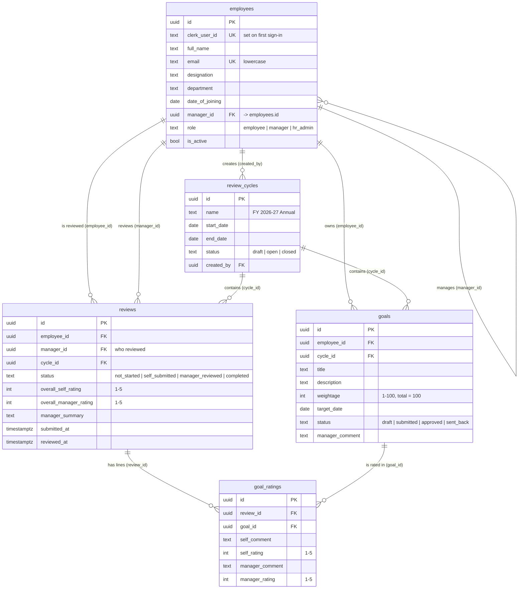
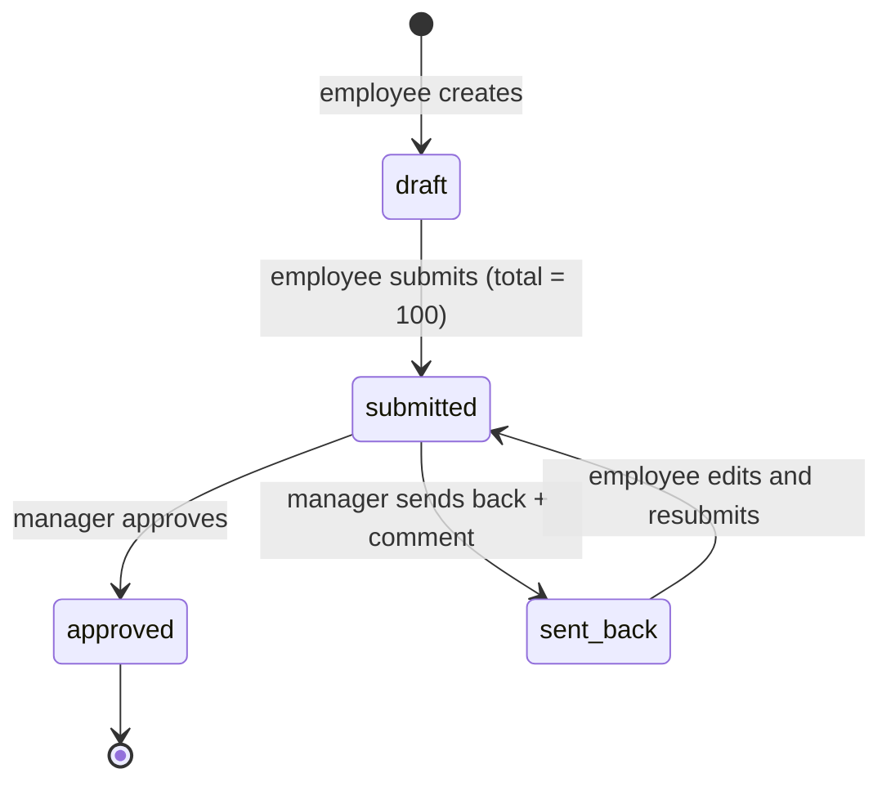
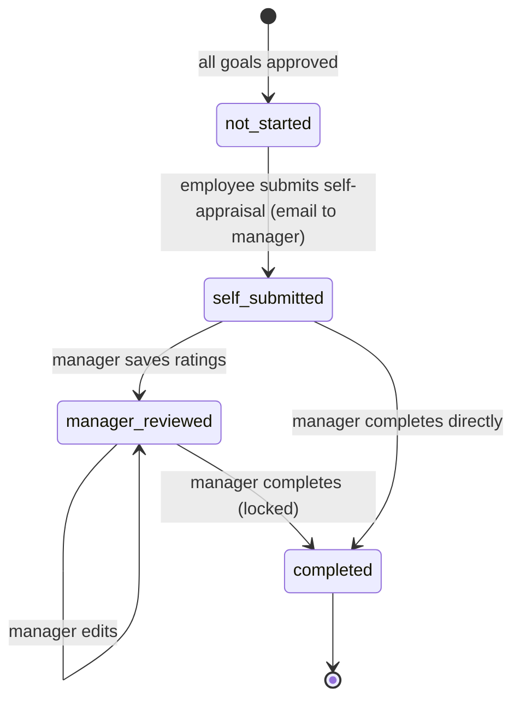

# Data Model

Five tables. GitHub renders the diagram below automatically.

## Why each table exists

| Table | One row means… | Key rule |
|---|---|---|
| `employees` | One person in the company | `manager_id` points back into the same table. A manager is simply someone who appears as another person's `manager_id`. |
| `review_cycles` | One appraisal period | A partial unique index allows only **one** open cycle at a time. |
| `goals` | One thing an employee plans to achieve in a cycle | Linked to a cycle, so years never mix. Weightages must total 100 before submitting. |
| `reviews` | One employee's appraisal for one cycle | `unique (employee_id, cycle_id)`. Its `status` column **is** the workflow. |
| `goal_ratings` | The self and manager rating for one goal | Kept separate from `goals`, because a goal is the plan and a rating is the outcome. |

## The two workflows

**Goal status**

**Review status**

## Who can see and change what (Row Level Security)

All five tables have RLS turned on. The rules live in `supabase/02_security.sql`.

| Table | Read | Write |
|---|---|---|
| employees | yourself, your direct reports, your manager; HR reads everyone | HR only |
| review_cycles | every signed-in user | HR only |
| goals | owner, owner's manager, HR | owner: create/edit/submit drafts in the open cycle. Manager: approve or send back submitted goals. |
| reviews | employee, their manager, HR | employee: save/submit while `not_started`. Manager: save/complete after submission. HR: read-only. |
| goal_ratings | anyone who can see the parent review | employee: self fields before submitting. Manager: manager fields after submission. |

The anonymous (signed-out) key has **no** table access at all.
